<picture>
  <source media="(prefers-color-scheme: dark)" srcset="assets/hero-dark.svg">
  
</picture>

  

Deux projets publics, deux sites en ligne : **[12testeurs](https://vavacry.github.io/12testeurs/)** et **[Perso](https://vavacry.github.io/perso/)**.

 

<a href="https://vavacry.github.io/12testeurs/">
<picture>
  <source media="(prefers-color-scheme: dark)" srcset="assets/12testeurs-dark.svg">
  
</picture>
</a>

<a href="https://vavacry.github.io/12testeurs/">Voir le site</a> · <a href="https://github.com/vavacry/12testeurs">Voir le code</a>

  

<a href="https://vavacry.github.io/perso/">
<picture>
  <source media="(prefers-color-scheme: dark)" srcset="assets/perso-dark.svg">
  
</picture>
</a>

<a href="https://vavacry.github.io/perso/">Voir la page</a> · <a href="https://github.com/vavacry/perso">Voir le code</a>

  

<picture>
  <source media="(prefers-color-scheme: dark)" srcset="assets/stack-dark.svg">
  
</picture>

  

<a href="https://vavacry.github.io/12testeurs/">
<picture>
  <source media="(prefers-color-scheme: dark)" srcset="assets/cta-dark.svg">
  
</picture>
</a>

